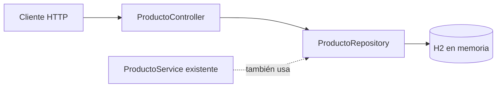

# API de productos · Java

**CS // SOFTWARE LAB — 02 / Práctica de backend**

API REST educativa para crear, consultar, actualizar y eliminar productos, controlar precio y stock, y calcular estadísticas de catálogo. El proyecto está en [productoapi](./CrusoJava/curso_java-main/productoapi).

## Tecnologías

Java **21**, Spring Boot **3.4.5**, Spring Web, Spring Data JPA, H2 en memoria y Maven. Thymeleaf y Actuator están declarados como dependencias; esto no prueba una interfaz completa.

## Arquitectura real



El controlador accede directamente al repositorio. Existe ProductoService, pero no está conectado al flujo del controlador. No se atribuye una separación completa de tres capas.

## Estructura

- `CrusoJava/curso_java-main/productoapi/pom.xml`: dependencias y Java 21.
- `src/main/java/com/cristhianstorm/productoapi/controller`: endpoints y validaciones.
- `model`: entidad Producto; `repository`: acceso JPA; `service`: servicio existente.
- `src/main/resources/application.properties`: H2 y puerto **8480**.
- `src/test`: prueba de contexto existente.

Las rutas src son relativas a productoapi. La carpeta target contiene artefactos históricos; recompilá desde las fuentes.

## Ejecutar

Requiere JDK 21. Desde la raíz del repositorio:

```powershell
cd CrusoJava/curso_java-main/productoapi
.\mvnw.cmd spring-boot:run
```

En Linux/macOS: `sh mvnw spring-boot:run`. Si el wrapper no puede descargarse porque faltan sus archivos auxiliares, usá Maven instalado: `mvn spring-boot:run`. La aplicación configura H2 en memoria: los datos no persisten al reiniciar. Puerto local: `http://localhost:8480`.

## Ejemplo de uso

```bash
curl http://localhost:8480/api/productos
curl -X POST http://localhost:8480/api/productos -H "Content-Type: application/json" -d '{"codigo":1,"nombre":"Teclado","descripcion":"Ejemplo local","stock":5,"precio":150000}'
curl http://localhost:8480/api/productos/1
curl http://localhost:8480/api/productos/estadisticas
```

En Windows podés usar `curl.exe` desde una shell compatible con la sintaxis del ejemplo.

| Método y ruta | Comportamiento |
| --- | --- |
| GET /api/productos | Listado. |
| POST /api/productos | Alta; rechaza precio no positivo, stock negativo y código existente. |
| GET /api/productos/{codigo} | Consulta individual; devuelve 404 si no existe. |
| PUT /api/productos/{id} | Actualización con validaciones de precio y stock. |
| DELETE /api/productos/{id} | Eliminación. |
| GET /api/productos/estadisticas | Cantidad, promedio de precio y disponibilidad; 204 sin productos. |

## Estado y mejoras propuestas

Práctica educativa; no se afirma validación de seguridad ni despliegue productivo. El endpoint de mensaje contiene una comprobación de API key de ejemplo que no protege todo el CRUD. Conviene integrar el servicio, ampliar validación de campos nulos, agregar pruebas HTTP y externalizar la configuración antes de usarlo fuera de un entorno local.

No se ejecutó la aplicación durante esta revisión de documentación. Para validar con JDK 21 y Maven: `mvn test` desde productoapi. No hay capturas de una UI de productos porque la pieza principal es una API.

---

[CS // Software Lab · Cristhian Storm](https://github.com/CristhianStorm)

